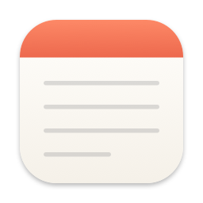
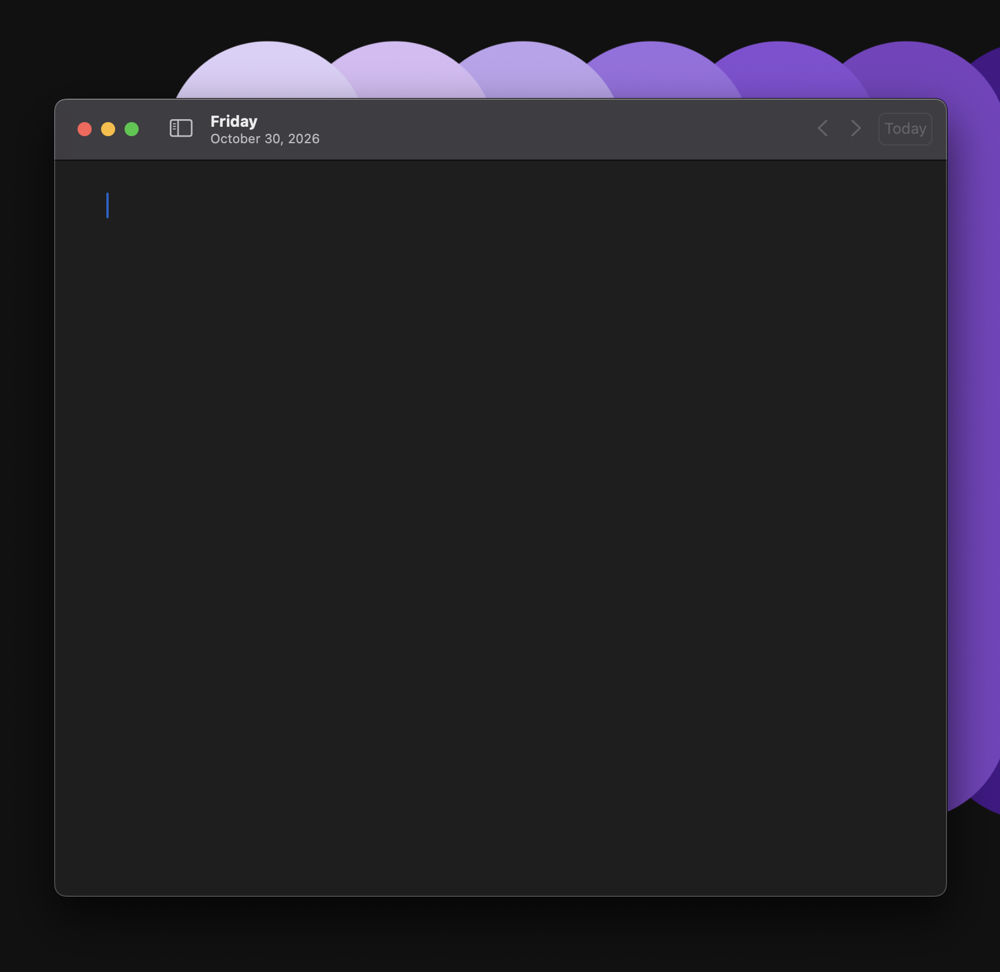

<p align="center">
  
</p>

<h1 align="center">Daily Note</h1>

<p align="center">
  A minimal macOS scratch pad. One blank page a day, saved as a plain Markdown file.
</p>

<p align="center">
  
</p>

## Why

I wanted somewhere to dump notes during the day: thoughts, todos, links, meeting scraps.
Every morning it should open to a clean page, and yesterday's page should still be one
keystroke away. No accounts, databases, tags or sync service. Just text files you own.

## Features

- **A new page every day.** Opens to today's page with the cursor ready to type. If the app is left open overnight, it moves to the new day on its own, but it won't switch pages while you're typing.
- **Plain files.** Each day is saved as `~/Documents/Daily Notes/yyyy-MM-dd.md`. You can open, grep, back up or sync them with anything.
- **Autosave.** Notes save shortly after you stop typing, when you switch apps and when you quit. There's no Save step (⌘S still works if you want it).
- **No clutter.** A day you don't write anything on gets no file.
- **Moving between days.** ‹ › buttons and ⌘[ / ⌘] step through the days that have notes. ⌘T jumps back to today.
- **Sidebar.** An optional list of your days, grouped by month, with a one-line preview of each.
- **Works with other editors.** Changes made in other apps (Obsidian, vim, iCloud Drive) show up when you switch back to Daily Note.
- **Native and small.** Built with SwiftUI and AppKit. It has no dependencies and follows the system light/dark mode. Text stays in a readable column on wide windows, with find, undo and spell check built in. Smart quotes are off so Markdown stays clean.

## Keyboard shortcuts

| Shortcut | Action |
| --- | --- |
| ⌘T | Go to today |
| ⌘[ | Previous day with a note |
| ⌘] | Next day with a note |
| ⌃⌘S | Show/hide the sidebar |
| ⌘F | Find in the note |
| ⌘S | Save now (notes also save automatically) |
| ⇧⌘R | Show the note in Finder |
| ⌘, | Settings |

## Settings

- **Notes folder.** Defaults to `~/Documents/Daily Notes`. If you pick a folder inside iCloud Drive, your notes sync across Macs.
- **Font.** System or monospaced.
- **Size.** 11 to 28 pt.

## Install

Daily Note is built from source. You need **macOS 14 (Sonoma) or later** and the Xcode command line tools (`xcode-select --install`).

```sh
git clone https://github.com/SteiniDavid/daily_note.git
cd daily_note
./scripts/build-app.sh --install
```

This builds `Daily Note.app`, signs it for local use only (an ad-hoc signature, not a developer certificate) and copies it to `/Applications`.
Leave off `--install` to just build it into `./build`.

The first time you open it, macOS asks to let Daily Note use your Documents folder. Allow it, because that's where your notes are saved.

> Ad-hoc signed apps aren't notarized. A copy you build yourself runs normally. If you send the `.app` to someone else, they'll need to right-click it, choose **Open** and confirm the first time.

## Development

```sh
swift build                 # debug build
swift run                   # run without bundling (no icon or bundle ID)
./scripts/build-app.sh      # release build packaged as build/Daily Note.app
```

The project is a Swift package. You can also open `Package.swift` in Xcode.

```
Sources/DailyNote/
├── DailyNoteApp.swift   App entry point, window, menu commands, app lifecycle hooks
├── NoteStore.swift      Notes folder, current day, autosave, day rollover, file index
├── NoteEditor.swift     NSTextView wrapper: plain text, centered column, undo/find
├── ContentView.swift    Window layout, toolbar, sidebar
├── SettingsView.swift   Settings window
└── Day.swift            A calendar day keyed by its yyyy-MM-dd string
scripts/
├── build-app.sh         Builds, bundles, signs and optionally installs the app
└── make-icon.swift      Draws the app icon
Resources/Info.plist     App bundle metadata
```

### How notes are stored

- One UTF-8 Markdown file per day, named by the local date: `2026-10-30.md`.
- Files are written atomically, so a crash mid-save can't leave a half-written note.
- If a note is cleared completely, its file is deleted. The sidebar's **Move to Trash** sends it to the macOS Trash, so you can get it back.
- The app has no other state besides a few preferences in `UserDefaults` (`local.dailynote`).

## License

[MIT](LICENSE)
